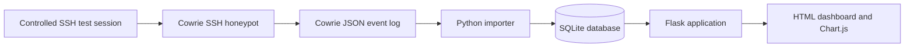
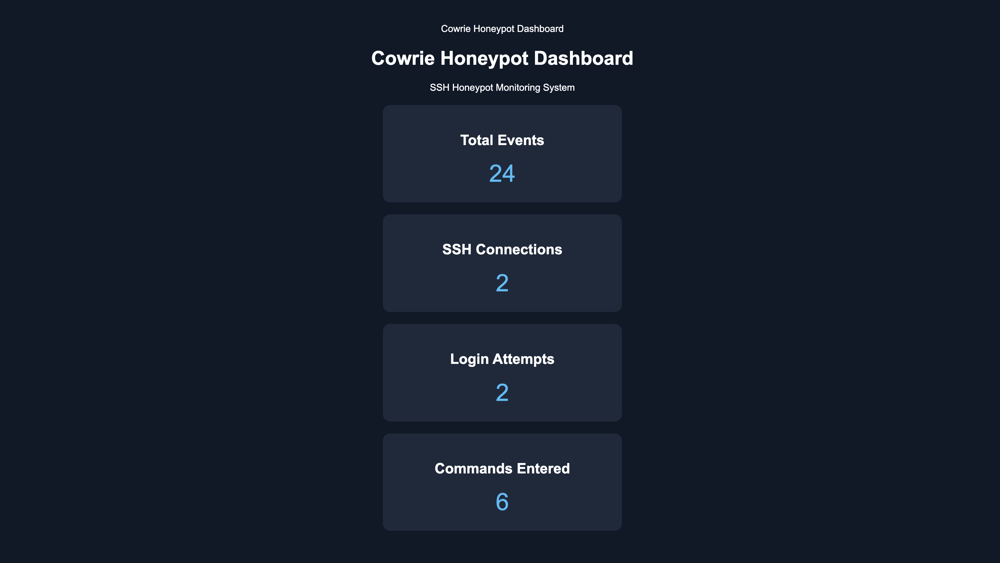
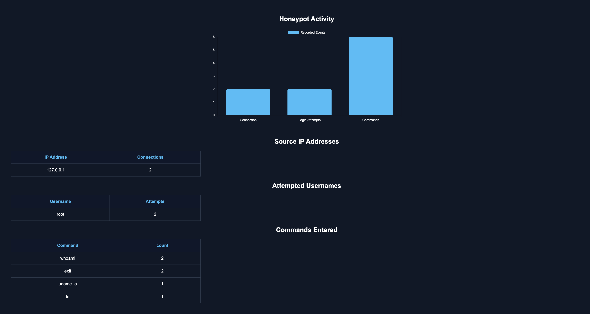

# Cowrie SSH Honeypot Monitoring Dashboard

**A local cybersecurity lab project that collects SSH honeypot telemetry and turns it into a searchable, visual monitoring dashboard.**

> **Project status:** Functional local-lab prototype. The dashboard has been tested with controlled SSH sessions; it is not a publicly deployed security monitoring service.

## Overview

This project combines [Cowrie](https://github.com/cowrie/cowrie), a medium interaction SSH honeypot, with Python, SQLite, and Flask. Cowrie records connection attempts, authentication events, and commands issued inside its simulated shell. A Python importer stores those events in SQLite, and a Flask dashboard presents the results through summary cards, a bar chart, and event-analysis tables.

The goal is to practice **security monitoring, log analysis, Python automation, SQL, and dashboard development** in a controlled environment.

## Features

- **SSH activity collection:** Records simulated-shell connections, authentication attempts, and entered commands from Cowrie JSON logs.
- **SQLite event storage:** Makes collected telemetry available for SQL queries and reporting.
- **Duplicate prevention:** Uses event hashes to avoid re-importing existing log entries.
- **Monitoring dashboard:** Shows total events, SSH connections, login attempts, and commands entered.
- **Activity visualization:** Uses a Chart.js bar chart to compare event categories.
- **Investigation tables:** Summarizes source IP addresses, attempted usernames, and commands.
- **Refresh-based updates:** Re-imports log data when the dashboard loads and refreshes the page every 10 seconds.

## Architecture



The application runs in an Ubuntu virtual machine. During development, the dashboard was opened in a MacBook browser through a local SSH port-forward.

## Technology Stack

| Component | Technology |
| --- | --- |
| Honeypot | Cowrie |
| Operating system | Ubuntu Linux (virtual machine) |
| Data collection and processing | Python 3, JSON |
| Database | SQLite |
| Web backend | Flask |
| Frontend | HTML, CSS, JavaScript, Chart.js |
| Lab access | SSH and local port forwarding |

## Project Files

```text
cowrie-honeypot-dashboard/
├── app.py                  # Flask routes and dashboard queries
├── import_logs.py          # Import Cowrie JSON events into SQLite
├── analyze_log.py          # Supporting log analysis script
├── templates/
│   └── dashboard.html      # Dashboard layout and chart
├── screenshots/            # Sanitized screenshots (added separately)
├── .gitignore
└── README.md
```

The SQLite database, raw Cowrie logs, local configuration, backups, and Python virtual environment are intentionally **not** included in the public repository.

## Running in the Existing Lab

This repository documents a working lab configuration rather than an automated Cowrie installer. To use the application, you need a running Cowrie installation, a compatible `events` table in your local `cowrie.db`, and the log path configured in `import_logs.py`.

From the Ubuntu project directory:

```bash
cd ~/cowrie-project
source cowrie-env/bin/activate
python3 import_logs.py
python3 app.py
```

With the Flask server running, browse to `http://127.0.0.1:5000` **inside the Ubuntu VM**. For the MacBook browser, establish an SSH tunnel **from the Mac** (replace placeholders with the Ubuntu login and VM address):

```bash
ssh -N -L 5000:127.0.0.1:5000 <ubuntu-user>@<vm-ip>
```

Then open `http://localhost:5000` on the MacBook. Keep the SSH tunnel and Flask process running while viewing the dashboard. The Flask development server is intended for this local lab only, not for production exposure.

## Validation

I tested the project using controlled SSH connections to Cowrie's local honeypot port (`127.0.0.1:2222`), including simulated commands such as `whoami`, `uname -a`, `ls`, and `exit`.

| Metric | Before test | After test |
| --- | ---: | ---: |
| Total events | 11 | 24 |
| SSH connections | 1 | 2 |
| Login attempts | 1 | 2 |
| Commands entered | 2 | 6 |

This test confirmed that new local honeypot activity was stored and displayed after refreshing the dashboard. Re-running the importer without additional activity did not increase the existing event count. **These were controlled lab interactions, not evidence of real-world external attacks.**


## Screenshots

### Dashboard Overview



### SSH Attack Activity



## Security and Privacy

- Cowrie and Flask were tested on local interfaces the project does not require exposing either service directly to the public internet.
- Never commit captured credentials, private IP/contextual data, raw Cowrie JSON logs, `.db` files, secret keys, or local VM configuration.
- Review files manually before publishing; `.gitignore` only filters matching untracked files and is not a substitute for a security review.
- Use only authorized lab systems for traffic generation.

## Current Limitations and Future Improvements

This version refreshes by reloading the page every 10 seconds, rather than streaming events in real time. Log importing also runs in the web request path. Future improvements could include a background importer, time-series activity charts, filtering by source IP or event type, and an automated database setup script.

## Learning Outcomes

Building this lab provided hands-on practice with SSH honeypots, JSON log ingestion, SQL aggregation, event de-duplication, Flask routing, front-end visualizations, and end-to-end functional testing.
